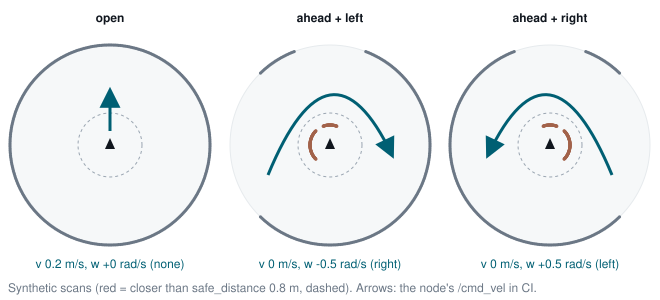

# Simple Autonomous Patrol Robot

ROS 2 Humble LifecycleNode that wanders a TurtleBot3 through Gazebo Harmonic: drive while the
front sector is clear, otherwise stop and turn toward the wider clear lane, refusing gaps
narrower than `min_lane_width`. Reactive, map-free, 10 Hz.

Stack: ROS 2 Humble · Gazebo Harmonic (gz-sim 8) via `ros-humble-ros-gzharmonic` · Python.


## Quick Start

```bash
sudo apt install gz-harmonic ros-humble-ros-gzharmonic ros-humble-turtlebot3-description \
                 ros-humble-xacro ros-humble-robot-state-publisher
mkdir -p ~/patrol_ws/src && cd ~/patrol_ws/src
git clone https://github.com/AungKaung1928/autonomous-navigation-obs-avoidance.git
cd .. && colcon build --symlink-install && source install/setup.bash

pkill -9 -f "gz sim"      # stale gz servers share the bus and corrupt /clock and /odom
ros2 launch simple_navigation_project patrol_gazebo.launch.py
```
`patrol_gazebo.launch.py` starts Gazebo Harmonic with `worlds/turtlebot3_world.sdf` (hexagon +
9 pillars), spawns the burger from `description/turtlebot3_burger.urdf.xacro`, bridges
`/scan /cmd_vel /odom /tf /clock` with `config/gz_bridge.yaml`, and starts the controller.
Arguments: `world`, `headless:=true`, `x_pose y_pose yaw`, `params_file`. A 6 x 6 m room with
a partition is available as `world:=.../worlds/wall_follow_world.sdf`.

Controller only (a simulator or robot already publishes `/scan`):
```bash
ros2 launch simple_navigation_project patrol_robot.launch.py
```

Without Gazebo: `cd src/simple_navigation_project && launch_test test/test_launch_scenes.py` (after `source install/setup.bash`) starts the installed node with the shipped parameters, feeds it synthetic scans and checks `/cmd_vel`: forward at 0.2 m/s when clear, a turn toward the open side when blocked ahead, then a clean exit. CI runs it in `ros:humble` on every push.



The node's decision per launch-test scene (CI run 1d1a5d5, CSV artifact plotted by `scripts/plot_scenes.py`): synthetic scans, the command it returned.

If `/scan` stops (no message for 0.5 s), the node publishes a zero `/cmd_vel` instead of driving on the last scan; `test/test_launch_stale_scan.py` checks this in CI. Lifecycle `deactivate` sends a stop first and the node then stays silent (`test/test_launch_deactivate.py`).

## Measured (Gazebo Harmonic, headless, 120 s, turtlebot3_world, spawn (-2.0, -0.5))
Independent 10 Hz recorder on `/odom` and `/scan`:

| Metric | Value |
|---|---|
| Path length | 19.3 m |
| Longest stall (net move < 5 cm) | 2.9 s |
| Closest scan return | 0.31 m (no contact; contact = < 0.16 m) |
| Decisions logged | 62 forward · 23 turn · 22 rotate-for-opening · 6 lane-too-narrow |

The trajectory circulates the whole arena (every 10 s sample lands in a different sector).


## How it works

1. Split the 360° scan into front, left and right sectors.
2. Front clear: drive at `patrol_speed`.
3. Front blocked: stop, compare left and right clearance, turn toward the wider side.
4. Refuse gaps narrower than `min_lane_width`; keep rotating until an opening appears.

Limits: reactive and map-free, so it wanders rather than covers; the longest stall in the measured run was 2.9 s.

More: what was fixed on 2026-09-05, parameters and tuning, monitoring, troubleshooting and the file layout in [docs/DETAILS.md](docs/DETAILS.md).

## License

Apache-2.0, see LICENSE.
